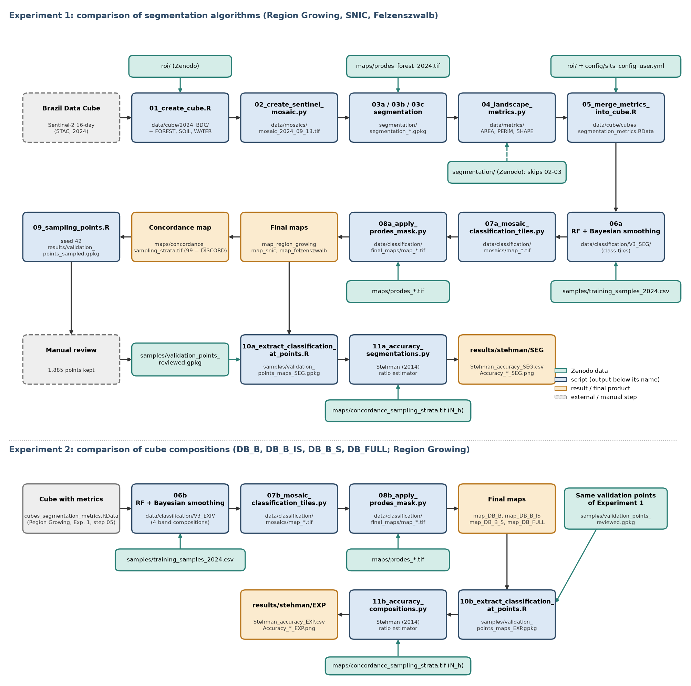

# Small-scale agriculture classification in the Alto Juruá

Code for the classification of small-scale agriculture in the Alto Juruá (Acre, Brazil) with Sentinel-2 time series, Random Forest and object-based metrics.

- **Code:** this repository (GitHub).
- **Data:** Zenodo, DOI [10.5281/zenodo.24203623](https://doi.org/10.5281/zenodo.24203623) (study area, training and validation samples, segmentations, classified maps, trained models).

## Setup

1. Clone this repository.
2. Download the zip archive of the Zenodo record, extract it and move the folders it contains (`roi/`, `samples/`, `maps/`, `segmentation/` and `models/`) into the root of the repository.
3. Run every script from the repository root. Intermediate files are written to `data/` and final tables and figures to `results/` (both are git-ignored).

## Requirements

- **R 4.4.1** with `sits` 1.5.2, `sf` 1.1.0, `terra` 1.9.11, `dplyr` 1.2.1, `readr` 2.1.5, `tibble` 3.3.1 and `randomForest` 4.7.1.2.
- **Python 3.14** with the packages of `requirements.txt` (`pip install -r requirements.txt`).
- **GRASS GIS** in a conda environment named `grass_obia` (script `03a`).
- **Brazil Data Cube** (STAC, collection `SENTINEL-2-16D`) for script `01`. Data last accessed on 13/11/2024.

## Pipeline

Steps 01 to 05 are shared by both experiments. Each experiment then has its own line of scripts (`a` = segmentation, `b` = cube composition).

### Shared steps

| Script | Step | Main input | Main output |
|---|---|---|---|
| `SCRIPTS/01_cube/01_create_cube.R` | Sentinel-2 16-day cube (BDC, 2024) with forest, soil and water fractions | `roi/` | `data/cube/2024_BDC/` |
| `SCRIPTS/02_mosaic/02_create_sentinel_mosaic.py` | Mosaic of 2024-09-13 (B11, B8A, B02, NDVI, SOIL, WATER, FOREST) | cube | `data/mosaics/mosaic_2024_09_13.tif` |
| `SCRIPTS/03_segmentation/03a_region_growing.py`, `03b_snic.py`, `03c_felzenszwalb.py` | Segmentation | mosaic, `maps/prodes_forest_2024.tif` | `segmentation/segmentation_*.gpkg` |
| `SCRIPTS/04_metrics/04_landscape_metrics.py` | AREA, PERIM and SHAPE of each segment, rasterized per tile | `segmentation/` | `data/metrics/` |
| `SCRIPTS/05_merge/05_merge_metrics_into_cube.R` | Regularization of the metrics and merge into the cube | `data/metrics/`, `config/sits_config_user.yml` | `data/cube/cubes_segmentation_metrics.RData` |

### Experiment 1: segmentation algorithms (`SCRIPTS/exp1_segmentation/`)

| Script | Step | Main input | Main output |
|---|---|---|---|
| `06a_train_classify_segmentations.R` | Random Forest (200 trees, seed 146) and Bayesian smoothing (window 13, neighborhood fraction 0.5, smoothness 20), one map per segmentation | cubes, `samples/training_samples_2024.csv` | `data/classification/V3_SEG/` |
| `07a_mosaic_classification_tiles.py` | Mosaic of the classified tiles | `data/classification/V3_SEG/` | `data/classification/mosaics/` |
| `08a_apply_prodes_mask.py` | PRODES masks (FLO = 13, NFLO = 14) | mosaics, `maps/prodes_*.tif` | `data/classification/final_maps/` |
| `09_sampling_points.R` | Stratified random sampling of validation points on the concordance map (seed 42) | `maps/concordance_sampling_strata.tif` | `results/validation_points_sampled.gpkg` |
| `10a_extract_classification_at_points.R` | Class of each map at the reviewed points | `samples/validation_points_reviewed.gpkg`, `maps/` | `samples/validation_points_maps_SEG.gpkg` |
| `11a_accuracy_segmentations.py` | Accuracy with the ratio estimator of Stehman (2014) | `samples/validation_points_maps_SEG.gpkg`, concordance raster | `results/stehman/SEG/` |

### Experiment 2: cube compositions (`SCRIPTS/exp2_composition/`)

| Script | Step | Main input | Main output |
|---|---|---|---|
| `06b_train_classify_compositions.R` | Random Forest and Bayesian smoothing for DB_FULL, DB_B, DB_IS and DB_S (Region Growing cube) | cube, training samples | `data/classification/V3_EXP/` |
| `07b_mosaic_classification_tiles.py` | Mosaic of the classified tiles | `data/classification/V3_EXP/` | `data/classification/mosaics/` |
| `08b_apply_prodes_mask.py` | PRODES masks | mosaics, `maps/prodes_*.tif` | `data/classification/final_maps/` |
| `10b_extract_classification_at_points.R` | Class of each map at the same reviewed points | `samples/validation_points_reviewed.gpkg`, `maps/` | `samples/validation_points_maps_EXP.gpkg` |
| `11b_accuracy_compositions.py` | Accuracy with the ratio estimator of Stehman (2014) | `samples/validation_points_maps_EXP.gpkg`, concordance raster | `results/stehman/EXP/` |

`SCRIPTS/check_model_gini.R` compares the retrained DB_FULL models in `models/` with the original model.

The maps, segmentations and validation points needed from step 09 onwards are provided in the Zenodo archive, so those steps can be run without the previous ones.

## Data (Zenodo)

| Folder | Content |
|---|---|
| `roi/` | Study area (shapefile) |
| `samples/` | Training samples, reviewed validation points with the class of each map, and the time series extracted at the training samples (`time_series/`) |
| `maps/` | Final classified maps (`map_*.tif`), concordance raster used as sampling frame, PRODES forest and non-forest masks |
| `segmentation/` | Region Growing, SNIC and Felzenszwalb segmentations (GeoPackage) |
| `models/` | Random Forest models: `original/` (DB_FULL of each segmentation) and `retrained/` (all experiments) |

Map names: `map_region_growing`, `map_felzenszwalb`, `map_snic` (segmentations, DB_FULL) and `map_DB_B`, `map_DB_B_IS`, `map_DB_B_S`, `map_DB_FULL` (cube compositions, Region Growing). Class codes: 1 AGPE, 2 AGUA, 3 AL, 4 DMC, 5 DMF, 6 PA, 7 PH, 8 PSI, 9 SE, 10 URB, 11 VSA, 12 VSI, 13 FLO, 14 NFLO; 99 in the concordance raster marks disagreement among the three segmentations.

## License

Code under the MIT License (see `LICENSE`).
